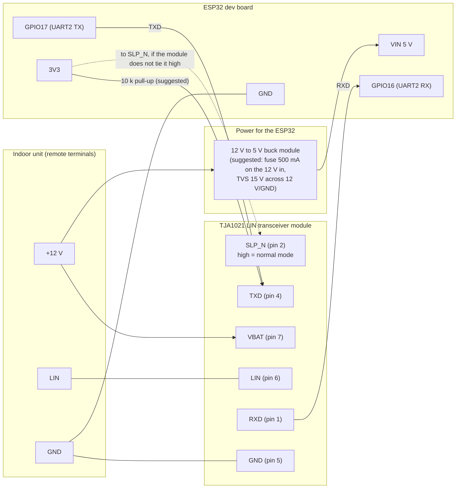
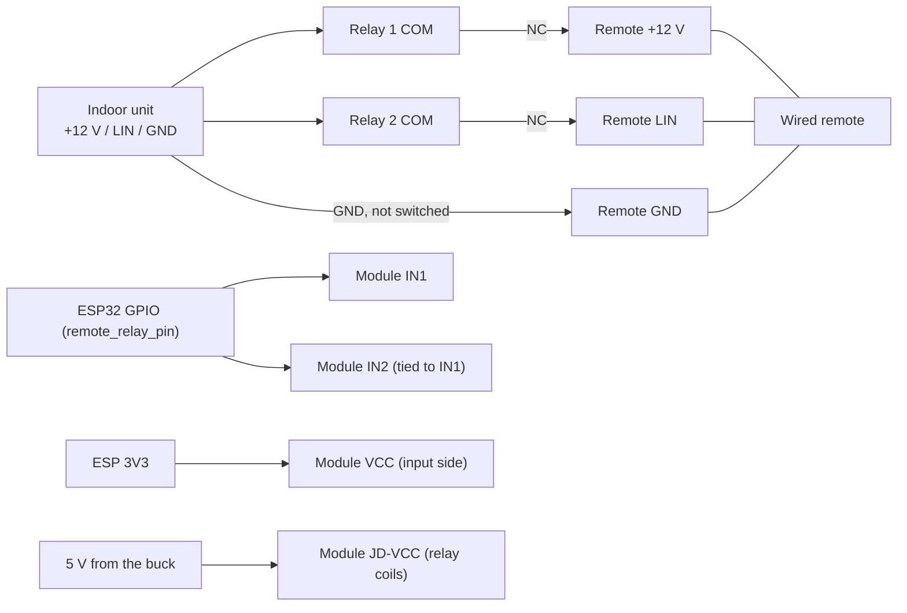
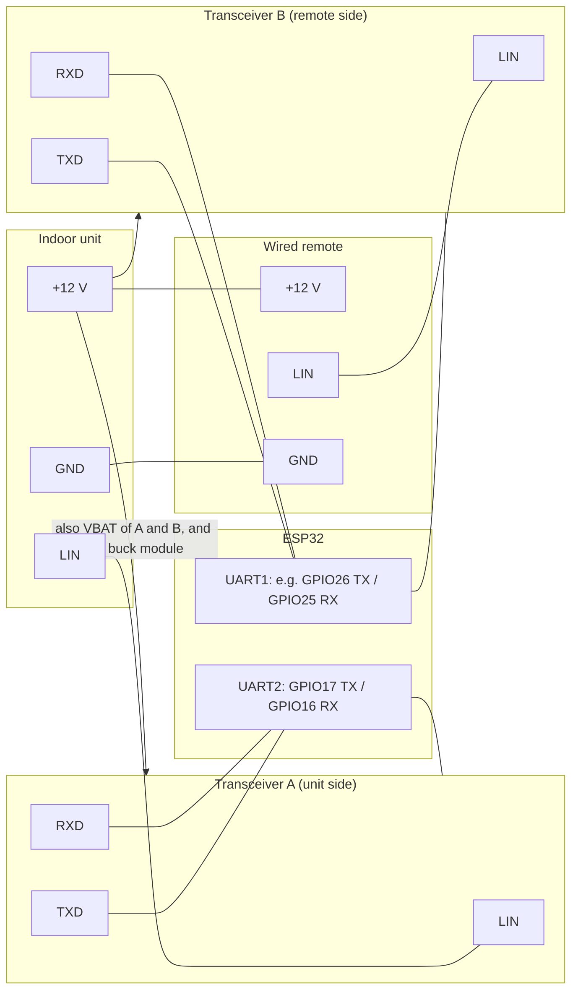

# AOT30L / ART30RL circuit

A suggested wiring for the [master controller](aot30-master-controller.md), and a sketch for the [bridge](aot30-master-controller.md#future-work-bridge-design-sketch-not-built).
The master controller wiring is the arrangement that ran successfully on 2 Nov 2026 (ESP32, a TJA1021 "linttl3" LIN transceiver module, GPIO16/17,
12 V and LIN from the remote's cable). The items marked **suggested** are additions I recommend but that have not been tried on this unit. Check every
voltage with a meter before connecting, and check your transceiver module's own pinout against its silkscreen: the pin numbers below are the TJA1021's.

## Facts the circuit relies on

- The remote's cable has three wires: **LIN** (signal), **+12 V** (the unit powers the remote) and **GND**.
- With the remote fully disconnected the LIN wire idles at **12 V**, so the unit already provides the bus pull-up. **Do not add a pull-up** on the master
  controller's side.
- An attached but unpowered remote clamps LIN to about 2.6 V, which is why all three wires must be removed from the remote, not just LIN.
- The ESP32's pins are 3.3 V; the TJA1021 accepts 3.3 V logic on TXD and drives RXD at the logic level of the module (check that your module's RXD is 3.3 V
  safe; many breakouts pull it up to 5 V).

## Master controller (the remote is removed)

| Connection | Notes |
|---|---|
| Unit +12 V to transceiver VBAT, and to the buck module input | The unit's remote-cable 12 V. |
| Unit LIN to transceiver LIN | The only signal wire. 12 V when idle. |
| Unit GND to transceiver GND and ESP GND | One common ground. |
| ESP GPIO17 to transceiver TXD | Idle high. The firmware drives it high at the start of `setup()` and bit-bangs it while transmitting. |
| Transceiver RXD to ESP GPIO16 | Firmware enables the internal pull-up on this pin so it cannot float and crash the ESP32. |
| 10 k from 3V3 to TXD (**suggested**) | Holds the transmitter recessive while the ESP32 boots, before the firmware takes over the pin. |
| SLP_N | Must be high for normal operation (low is sleep). Many modules tie it high, check yours. WAKE_N is not needed; INH is not used. |
| ESP32 supply | Powering it from the same 12 V through a buck module is the robust option. During the experiments it also ran from USB 5 V for the web logs; the GND must still be common. |
| Optional: status LED | GPIO2 (as in `aot30.yaml`). |

**Protection (suggested):** a small fuse in the 12 V feed and a TVS diode (for example 15 V standoff) across 12 V and GND at the module, since the line runs
through the building and the remote's cable. A series resistor is not needed on LIN; the transceiver handles the bus.

## Remote relay for the takeover design (a standard relay module)

Two relays cut the wired remote's **+12 V** and **LIN** together (ground stays connected). One ESP32 GPIO can drive both relay inputs in parallel (set `remote_relay_pin` in `aot30.yaml`). Untested.

- **Contacts:** use COM and the **normally-closed** (NC) terminal on each relay. Coil off = remote connected, so an ESP that is unpowered or booting leaves the remote working.
- **Polarity:** most 4-channel modules are **active low** (input low = relay on). Then use `remote_relay_inverted: true`: the pin idles high (relay off, remote connected) and goes low during a takeover. If your module is active high, leave it false.
- **3.3 V logic on a 5 V module:** a 3.3 V "high" can leave the optocoupler LED slightly on when the module's input side is powered from 5 V, so the relays may half-operate. Fix: remove the JD-VCC jumper, power **VCC from the ESP's 3.3 V** and **JD-VCC from 5 V**, so the inputs are isolated and 3.3 V switches them cleanly. Check that your module has optocouplers; a transistor-only board is more likely to misbehave.
- **Do not power an SRD-05VDC relay from 12 V.** The part number SRD-05VDC-SL-C is a **5 V coil** relay; 12 V would run it at about six times its rated power and burn the coil. Power the module's relay side (JD-VCC, or VCC if the jumper is fitted) from the **5 V from the buck**, with GND common to the ESP. (A 12 V module, SRD-12VDC, would be needed to run the coils from 12 V.)
- **Does it have optocouplers?** A JD-VCC header with a jumper is normally found on the optocoupler versions. Look for four small 4-pin chips marked 817, PC817 or EL817 beside the input pins. If they are there, follow the VCC-from-3.3 V and JD-VCC-from-5 V wiring above. If there are none (a transistor-only board), do not drive it straight from 3.3 V: on a PNP board a 3.3 V "high" does not switch it off when the board is on 5 V, so the relays could stay energised. Drive each input through a small NPN or N-MOSFET instead (GPIO to the base through about 1 k, emitter to GND, collector to the module's IN). That stage inverts, so an active-low module then switches on when the GPIO goes high: leave `remote_relay_inverted: false` (pin low = remote connected, pin high = cut). Or buy a 3.3 V-compatible opto module.
- **Operator's experience (3 Nov):** the module (SRD-05VDC-SL-C relays, JD-VCC jumper fitted) has previously worked powered from the ESP32 board's 5 V pin with a 3.3 V GPIO driving the input directly, so that simple wiring is acceptable; the checks above are for modules that misbehave. Still confirm both relays are off with the pin idle before connecting the remote.
- **Where the 5 V comes from (3 Nov):** the ESP32 is fed from a dev board that takes the unit's 12 V and has a 5 V output. Check what regulates it. If it is a **buck converter** (an inductor and a switching chip such as MP1584 or LM2596) rated 1 A or more, powering the relay module from its 5 V output is fine. If it is a **linear regulator** (a 3-pin or SOT-223 part such as AMS1117 or LM1117), do not load it with the relays: it would drop about 7 V across itself at several hundred milliamps and overheat (the ESP32 alone can draw 300 mA or more in WiFi bursts). In that case run the relay module from a small separate 12 V to 5 V buck module with a common ground.
- **Avoid brown-outs when the relays click:** two coils pulling about 150 mA at once can dip a shared 5 V rail and reset the ESP32. Put a 470-1000 uF capacitor across the 5 V at the relay module and keep the wiring short; a separate buck for the relays avoids it entirely. In permanent-master mode (Master Controller switch on) the relays stay energised continuously, so the supply must carry that load all the time, whereas in takeover mode they are on only for a few seconds per change.
- **Check before connecting the remote:** with the ESP idle (relay pin at its inactive level) neither relay may be energised; measure or listen for a click and check the LEDs on the module, then set the pin active and confirm both switch.
- **Load on the pin:** each opto input draws a few milliamps, so two in parallel are fine for one GPIO. Tying IN1 and IN2 together on the module header is neat.
- **GPIO choice:** pick an output pin that is not a strapping pin (avoid GPIO0, 2, 12, 15) and is high-impedance at boot, for example GPIO25, 26 or 27, so the relays do not click at power-up.
- **5 V supply:** two relay coils draw roughly 70-90 mA each; check the buck module has margin on top of the ESP32.
- **Contact type:** these are power relays. At the few milliamps of the LIN line their contacts can occasionally be unreliable ("dry circuit"). Try them; if the remote or the bus is flaky, use signal relays (gold contacts). The module's flyback diodes already handle the coils.
- **Ratings:** a module's contacts are normally rated well above 12 V DC at the remote's tens of milliamps, so rating is not an issue.

## Bridge (sketch, not built)

For the bridge the remote stays, so its 12 V and ground still come from the unit; only the **LIN wire is split** into two buses.

- 12 V and GND pass straight through to the remote, so the remote is powered exactly as before. Add the fuse and TVS at the unit end.
- Transceiver A is the same as in the master controller circuit. Transceiver B faces the remote, which acts as a bus master on its own wire.
- **To verify before building:** whether the remote-side wire idles high on its own. If it does not (the unit may provide the pull-up in the original
  installation), the remote side needs a pull-up to 12 V (typically about 1 k in series with a diode, as for a LIN master). Measure the original LIN
  wire with the remote connected and the unit powered; the earlier multimeter reading was 8.2-9.3 V, which suggests an average of a pulsing line rather than
  a plain high level, so look at it with the logic analyser.
- The second transceiver also needs the same TXD pull-up and the pin choices above must not clash with the strapping pins (GPIO0, 2, 12, 15) or the
  flash pins.

### What is shared and what is repeated

| Built once | Repeated for each transceiver (A and B) |
|---|---|
| 12 V feed from the unit, one fuse, one TVS diode | 10 k pull-up from 3V3 to TXD (holds it recessive while the ESP32 boots) |
| Buck module and the ESP32 | SLP_N tied high (unless the module already does it) |
| Common ground and the 3V3 rail | VBAT supply connection and a local 100 nF decoupling capacitor (most breakouts already have one, check yours) |
| Remote's 12 V and GND, passed straight through from the unit | Its own TXD/RXD pair on its own UART |

- No capacitor is needed on the LIN pin for a short in-building run (the 220 pF-1 nF EMC capacitor used in vehicles is optional).
- **Not simply a copy of A:** the remote-side wire may need a pull-up to 12 V (about 1 k in series with a diode), because the unit provides the pull-up today and
  the remote would no longer be connected to it. Measure before building.
- One transceiver cannot serve both buses, because the ESP has to talk to the unit and answer the remote at the same time. Software side: the unit-side
  half is the existing `Aot30Bus` master; the remote side would be a new slave class plus a cell-level decoder for the remote's settings.
