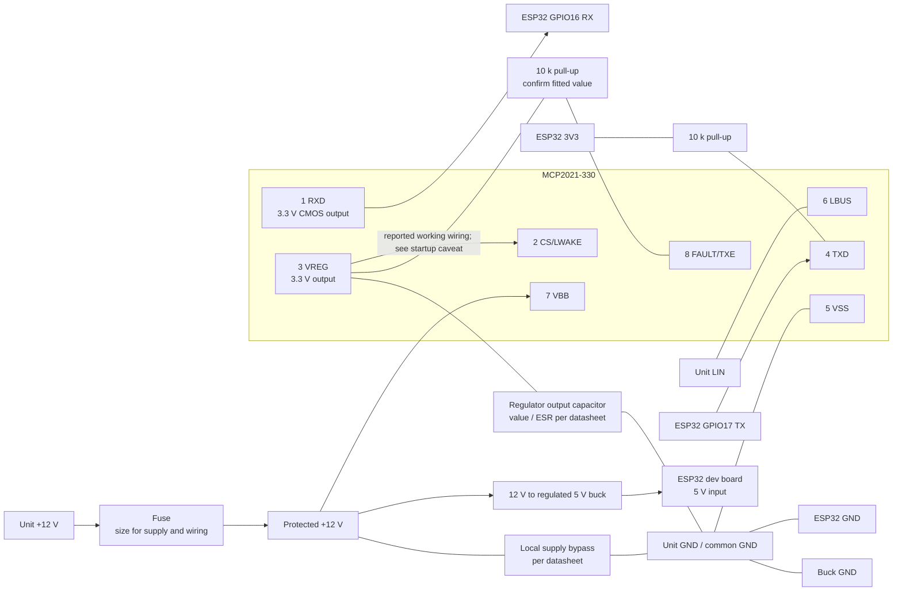
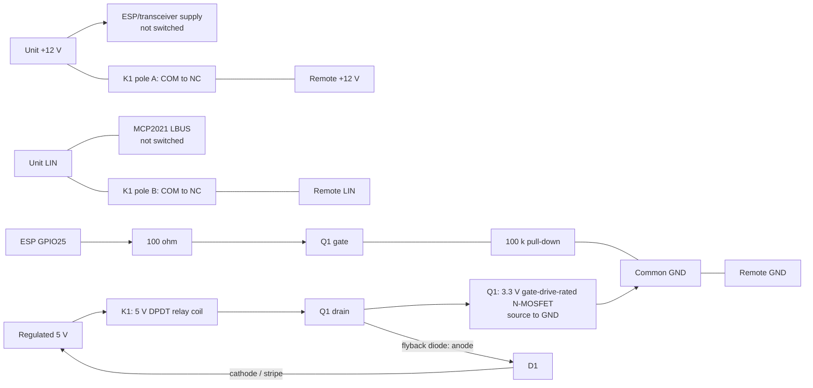

# Circuit: ESP32, LIN transceiver and optional remote isolation

The working reference uses a **Microchip MCP2021-330**, not a prebuilt LIN board.
The linked predecessor project used a TJA1021 / "linttl3" board. This is a wiring
summary, not a validated PCB schematic; automatic relay isolation remains untested.

## ESP32 and MCP2021-330

Pin numbers below are for the 8-pin MCP2021-330. Its VREG output is **3.3 V,
50 mA maximum**: it does not power the ESP32.

- **Common ground throughout.** Never connect LIN or +12 V directly to an ESP GPIO.
  MCP2021-330 RXD is a 3.3 V CMOS output, not an open-drain pin needing a pull-up.
  The external TXD pull-up shown is a suggested boot precaution, not a confirmed
  part of the tested circuit; TXD also has an internal pull-up to VREG.
- **Reported working enable wiring:** pin 2 tied to pin 3; pin 8 believed to have
  a 10 k pull-up to pin 3 (confirm on the actual circuit). Microchip advises
  **against tying CS/LWAKE directly to VREG**, because transmission may enable
  before the microcontroller initialises. New designs should use a controlled
  enable after TXD is recessive; this component currently has no enable-pin option.
- VREG requires an output capacitor with the capacitance/ESR specified in the
  [Microchip datasheet, DS22018E](https://ww1.microchip.com/downloads/en/DeviceDoc/22018E.pdf).
  Its fitted value has not been confirmed. Do not connect VREG to the ESP's
  separately powered 3V3 rail.
- The reference unit already pulls LIN high to about 12 V. **Do not add another
  master pull-up.** Keep wiring short; size supply/protection for the ESP's
  WiFi peaks and any relay coils. Do not feed 12 V into the dev board's 5 V input.
  The reference uses a 12 V-input ESP carrier with onboard regulation; a separate
  12 V-to-5 V buck feeding an ESP dev board is the alternative shown above.

## Optional remote isolation: two normally-closed contacts

Leave the ESP/transceiver permanently on the **unit side**. Switch only the
remote's +12 V and LIN branches; ground stays connected.

- K1 de-energised = remote connected; energised = remote power and LIN isolated.
  Use `remote_relay_pin: 25`, `remote_relay_inverted: false` for this driver.
  Choose Q1, diode and supply for the coil current; **never drive a coil from GPIO**.
- Prefer signal-rated contacts suitable for low-current loads. A basic mechanical
  contact should pass the approximately 500-baud signal when closed; switching
  bounce can interrupt traffic. Validate handover on the actual hardware.
- A two-channel relay module can replace K1 and its driver. Use both COM/NC
  contacts, verify 3.3 V input compatibility and boot-off behaviour, and set
  inversion to match the module. **SRD-05VDC coils require 5 V, not 12 V.**
- Both branches must open: an unpowered remote left on LIN clamps the reference
  bus low. Enable the remote's memory function for the tested hand-back behaviour.
  Manual disconnect/reconnect was tested; automatic relay switching was not.

## Bring-up

Power down before changing wiring. Verify supply voltage, GPIO levels and relay
contact continuity before connecting the unit. First boot is **passive** with no
relay pin configured; confirm the original remote still works and received bus
traffic is recognised before enabling control.

See the [first-time checklist](../README.md#first-time-bring-up-listen-before-controlling)
and [controller guide](aot30-master-controller.md). A two-transceiver bridge is a
separate, unimplemented design, not required for this circuit.
