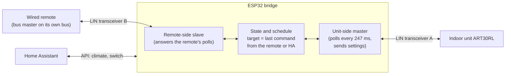
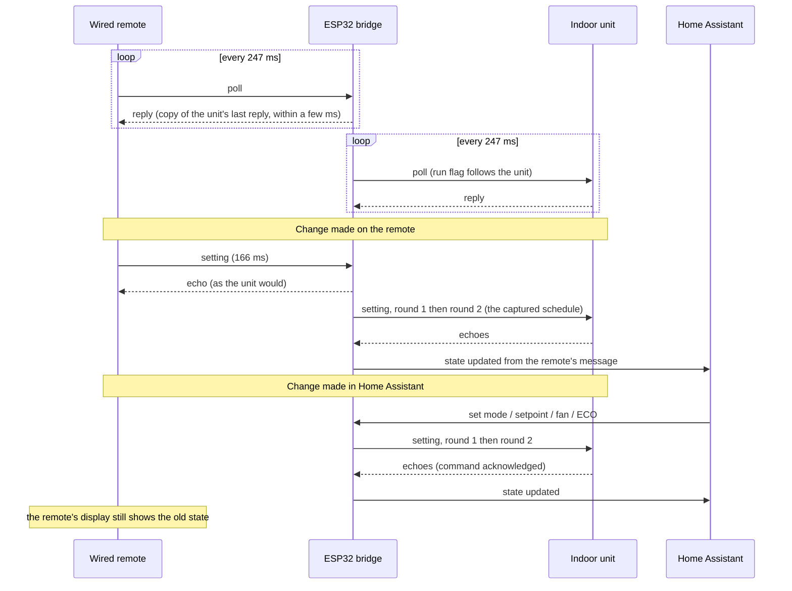
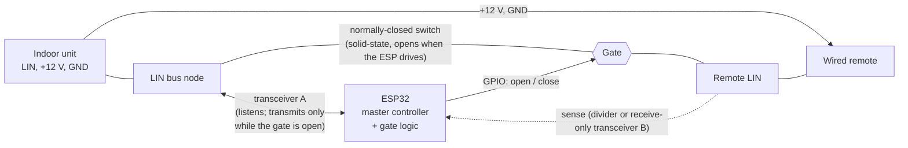
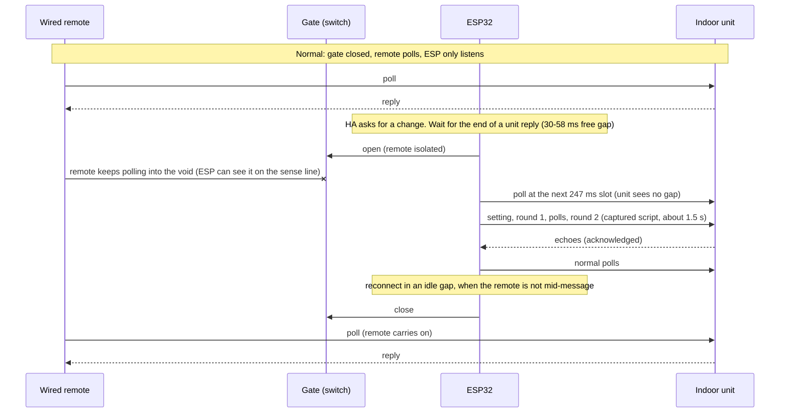
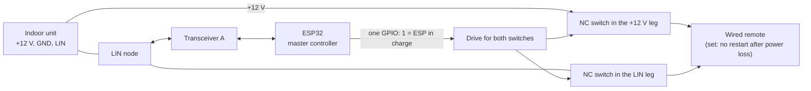
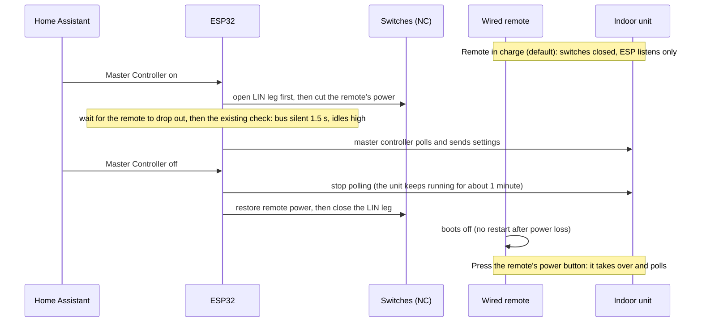
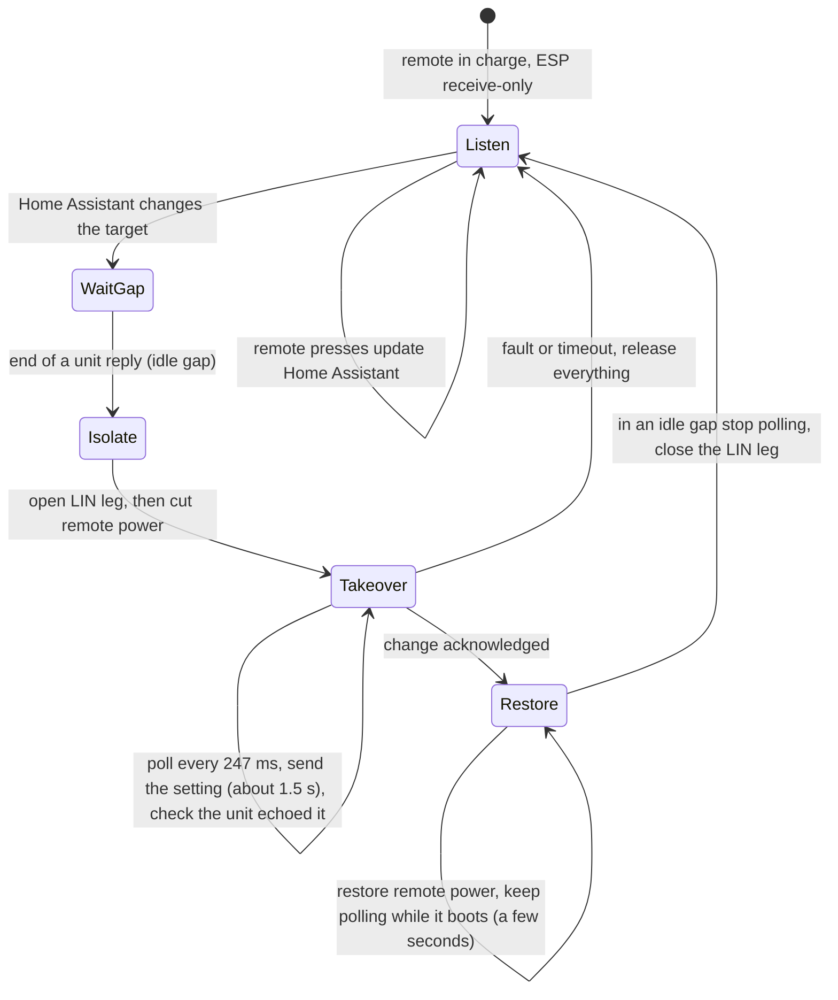

# AOT30L / ART30RL master controller

Status: **experimental**. The protocol work is based on logic-analyser captures and one successful run on real hardware (2 Nov 2026, remote
disconnected, unit started from the ESP). The `fujitsu_aot30` component (Master Controller switch, climate entity) has passed the host tests but has
**not yet been built or run on the ESP32**.

This is a separate component from the original `fujitsu_climate` (the newer units' 8-byte frame protocol, unchanged from upstream): see the
[README](../README.md#which-component-for-which-unit).

## What it does

The older ducted Fujitsu units (indoor ART30RL, outdoor AOT30L, wired remote part 9364911014, 3-wire LIN-style bus at 12 V) do not talk the
8-byte frame protocol of the newer units. The wired remote is the **bus master**: it polls the unit about every 247 ms and the unit only
replies. So Home Assistant control means the ESP32 **replaces the wired remote**:

- It polls the unit continuously, exactly as the remote does.
- Climate commands (mode, setpoint, fan, ECO, off) are turned into the captured setting and off messages.
- The unit shuts itself off when polling stops, so turning the master controller off also turns the unit off.

The physical remote cannot stay connected. A setting message is 164 ms long, the free gap next to a live remote is 30-58 ms, and the unit rejects a
setting sent even 20 % faster (speed-ladder test, 2 Nov 2026). Keeping the remote needs a bridge, see [Future work](#future-work-bridge).

## Hardware

- ESP32 with a LIN transceiver (TJA1021, "linttl3"). RX is GPIO16, TX is GPIO17 (see `aot30.yaml`). A suggested circuit is in [aot30-circuit.md](aot30-circuit.md).
- Transceiver powered from 12 V. Power the ESP32 from 5 V or from the 12 V rail through a regulator.
- **Disconnect the wired remote completely: LIN, power and ground.** An attached but unpowered remote clamps the LIN line low (measured 2.6 V);
  with all three wires removed the LIN idles at 12 V.

## Home Assistant entities

| Entity | Purpose |
|---|---|
| **Master Controller** (switch) | On: the ESP takes over the remote's role. Remembered across reboots. It turns itself off if the controller refuses to start or has to stop. |
| **Master Controller Status** (text) | `Off`, `Checking bus`, `Running`, or why it refused or stopped (see below). |
| **Master Last Command** (text) | Whether the unit echoed the last setting or off message (`Acknowledged by the unit` / `Not acknowledged by the unit`). The unit repeats what it accepts, so this checks every command, including setpoints and modes not yet tried on the real unit. |
| **Unit Running** (binary sensor) | The run flag in the unit's own replies. Unknown until the unit has answered a poll. |
| **Bus Alive** / **Bus Status** | Recognised messages are arriving (`Bus OK`, `No Signal`, `Never Seen`). Works with the Master Controller off and the real remote connected. |
| **Fujitsu Heat Pump** (climate) | Modes Off/Auto/Cool/Heat/Fan, setpoint, fan Auto/Low/Medium/High, preset ECO. While the master controller runs, the climate state is the last state the ESP commanded. With the Master Controller off, commands are ignored and the state is a best-effort view of a connected remote (see Known limits). |
| **Mode**, **Set Temperature**, **Fan Speed**, **Economy Mode** | Duplicates of the climate controls for the ESPHome web UI (its climate row has no usable mode or fan control) and for Auto mode, where HA hides the target temperature. |

In Home Assistant the climate entity (`climate.fujitsu_heat_pump`) appears by itself once the device is added; show it with a Thermostat card (the
auto-generated dashboard already does). Its mode list is Off/Auto/Cool/Heat/Fan only. Commands do nothing until the Master Controller switch is on.

Supported: HEAT 16-30 °C, COOL 18-30 °C, AUTO 18-30 °C, FAN (no setpoint), fans auto/low/medium/high, ECO.
Not available on this unit: DRY, quiet fan, vane control (so no swing entity), room temperature. Out-of-range setpoints are clamped. The room temperature is not on the bus.

## Installing

Use [`aot30.yaml`](../aot30.yaml) (rename the device if you like) and keep `components/fujitsu_aot30/` next to it, or point `external_components` at the
repository instead of the local path:

```yaml
external_components:
  - source:
      type: git
      url: https://github.com/matt-nz/Retro-Fujitsu-ESPHome
      ref: <branch>
    components: [ fujitsu_aot30 ]
```

`debug: true` on the climate platform logs every received byte as `RX raw` lines (what `tools/decode_timeline.py` reads); set it to `false` for quieter logs.

## Starting it

1. Disconnect the wired remote (all three wires) and power the unit.
2. Turn on **Master Controller**. It checks that the bus is silent for 1.5 s and idles high, polls for 2 s, then reports `Running`.
3. Use the climate entity. A change takes about 1.5 s to go out (two setting rounds, as the remote sends them).
4. Turn the switch off to stop. The unit shuts down.

## Safety behaviour

| Status | Meaning |
|---|---|
| `Refused: wired remote is on the bus` | Wired-remote messages were heard while checking. Disconnect the remote and try again. |
| `Refused: bus held low` | The LIN line did not idle high. Check that the remote is fully disconnected and the line reads 12 V. |
| `Stopped: wired remote detected` | Two remote messages were heard while running; the bus was handed back at once. |
| `Stopped: bus fault while sending` | Three transmitted cells did not read back correctly (another device on the line, or a wiring fault). |

Every transmitted cell is read back from the bus. The ESP never transmits within 12 ms of the last received byte, and always releases the pin
(idle high) after a message. The transmit pin is driven high early in `setup()`.

## Known limits

- The climate state is what was commanded, not what the unit reports. Only the run flag comes from the unit (`Unit Running`). Setting echoes
  cannot be decoded from the byte view (the old `0x96` "unmapped" log line is that aliasing).
- **The shown state follows a command only after it was actually sent, and goes back if the unit does not echo it** (`Master Last Command` says which). A command that could not be sent, or that the unit ignored, therefore does not stay on the Home Assistant card.
  (Found in Nov 2026 logs: every command ended with `Master: invalid setting, stopping` because an unset target started as fan 0, and the failed command was still shown. Fixed: an unset or invalid target falls back to HEAT / fan auto / 20 °C, an invalid setting is refused instead of stopping the master, and the display waits for the send.)
- If the ESP reboots or loses power, the unit kept running for 1 minute in the one timed test (it shut down exactly 1 minute after the last poll, with the
  compressor not running; with the compressor running for a while it may differ, untested). So a reboot or WiFi drop should not switch it off. An OTA
  update plus reboot takes a good part of that minute, so do not rely on it for long gaps. The Master Controller switch is restored on boot.
- The unit occasionally skips a reply (3 of 52 polls in one capture). The master tolerates that.
- Round 2 of a setting was missing from the unit's echo 3 times in 50 on the real remote; it makes no difference here.

## Protocol summary

The full protocol is in [aot30-protocol.md](aot30-protocol.md).

- Code, all in `components/fujitsu_aot30/`: `Aot30Cells.h` (message cells), `Aot30Scheduler.h` (timing script), `Aot30Passive.h` (message parser), `Aot30Bus.cpp` (bus task: reading, master controller, bit-banged transmit), `Aot30Climate.cpp` (HA climate entity).

## Tests

`sh tests/run_all.sh` runs everything on a desktop: the cell encoder against 677 golden vectors from the Python model, the scheduler, and the
master controller with fake time, GPIO and UART. ESPHome itself is built in the HA add-on.

## Future work: bridge (design sketch, not built)

A bridge keeps the physical remote usable. The ESP sits between the unit and the remote with a **second LIN transceiver** and treats the two as
**independent buses**: master towards the unit, slave towards the remote. It never has to delay the remote, because it answers the remote's polls itself,
from the unit's latest reply, within the few milliseconds the remote expects (the reply starts 1.75-6 ms after the poll ends).





- **What is already built:** the unit-side master (`Aot30Bus`, `Aot30Scheduler`, `Aot30Cells`) is exactly the current master controller.
- **What is new:** a second UART and transceiver for the remote side, a slave that can answer a poll in a few milliseconds, and a receive-only decoder for the
  remote's setting cells (GPIO edge timestamps), because the byte view aliases (see [aot30-protocol.md](aot30-protocol.md#5-the-byte-view-and-why-it-aliases)).
- **Open questions:** how the remote reacts to synthetic echoes and replies (does it accept them, does it show a fault), what it sends at the very start of a
  cold start with no unit answering, and whether the remote's display can be made to follow Home Assistant's changes by echoing a setting to it. If the
  remote's display cannot follow, the two will show different states after a change from Home Assistant.

## Alternative: keep the remote and gate its LIN wire with a switch

Idea: leave the real remote and the ESP both wired. A switch in the remote's **LIN leg only** (the remote keeps its 12 V and GND) isolates the remote while the ESP is the
master, and reconnects it afterwards. The remote polls normally the rest of the time, so there is no second transceiver to transmit with, no reply emulation and no RMT.
This is a design sketch, **untested**, and it has real unknowns (below).





**Why it is attractive**
- It reuses the existing master controller unchanged (it already runs the full script with read-back); the new parts are a switch, one GPIO and a hand-over state machine.
- The ESP already coexists with the live remote as a listener (the passive logging worked with the remote connected), so normal use is unaffected.
- Fail-safe: use a **normally-closed** switch so that if the ESP loses power the remote is simply connected again.

**Hand-over timing.** The unit's reply ends, then 30-58 ms are free before the next poll. Open the gate inside that gap and send the ESP's own poll at the next 247 ms slot, so the unit never sees a missing poll
(the remote's poll interval is steady: median 246.6 ms, sd 5 ms). Close it again only in a gap when the remote is not mid-message: with a **sense input** on the remote side
(a divider to a GPIO, or a receive-only second transceiver with TXD held recessive) the ESP can watch the remote's polls, and any button press, while it is isolated.
Without sense, the remote's phase is only predictable to about ±5 ms, so a message could be cut at reconnect.

**Switch.** A solid-state (photo-MOSFET) normally-closed relay or a back-to-back MOSFET pair rated well above 30 V, with an on-resistance of a few tens of ohms or less (LIN dominant
current is small), switching in about a millisecond. Avoid a mechanical relay: its 5-10 ms operate time and bounce are too coarse for a 30-58 ms gap. When open, the remote's LIN pin
floats, so it probably needs a pull-up to 12 V on its side (about 1 k in series with a diode) to see an idle bus rather than noise; to be measured.

**Unknowns that decide whether it works** (the first can be tested now with no hardware: with the remote connected, unplug only its LIN wire for 2 s, then 10 s, and see what the remote does)
1. **How the real remote reacts to losing the unit's replies for a couple of seconds:** an error display, a reset, a re-sent state? It polls into the void for about 8 cycles per change.
2. **Whether the remote re-sends its own stored settings after an interruption.** If it does, it will overwrite Home Assistant's change ("keeps changing back").
   **Tested 3 Nov 2026: it does.** As soon as the remote's LIN wire was reconnected it re-sent its settings. So a gate on the LIN wire alone fails: the remote would overwrite
   Home Assistant's change every time it is reconnected. The idea below (cutting the remote's power as well, with the remote set not to restart after a power loss) is the next thing to try.
3. **A button pressed on the remote during isolation:** it is lost unless the ESP captures it from the sense line and replays it (needs the cell decoder).
4. **Display mismatch:** the remote's display will still show its old state after a change from Home Assistant, as in the bridge.

**Compared with the other options:** less work than the bridge (no remote-side slave, no 6 ms reply deadline, no RMT), more than the touch-screen master (a switch, sense input and
hand-over logic, and it depends on the unknowns above). It keeps the old remote usable, which the touch-screen master does not. A sensible order is to run the unplug experiment first;
if the remote tolerates a few seconds without replies and does not re-send its state, this becomes the best way to keep both.

## Alternative: one controller at a time, with the remote's power and LIN switched

Since the remote re-sends its settings when it is reconnected, never let it join the bus while the ESP is in charge. Instead make it a **changeover**: either the remote is
powered and connected, or the ESP is the master with the remote fully removed, never both. The remote is set not to restart after a power loss, so that when it is powered
up again it comes up off and does not push stored settings at the unit. Design sketch, untested.



**The switches must default to "remote connected".** Use **normally-closed solid-state relays** (photo-MOSFET, 1-Form-B), one in the remote's +12 V leg and one in its LIN leg (or a dual
part). The ESP drives the relays' LEDs from one GPIO: LED off means closed, so the remote is powered and connected. If the ESP is unpowered, crashed or still booting, the remote
works as it did originally. This also answers "how do I power the remote back if the ESP is active": the ESP only ever *cuts* the remote, and the default state, with no ESP involvement,
is powered. Pick parts rated well above 12 V (60 V class) with a current rating above the remote's draw, which should be measured. A manual two-pole changeover switch does the same
job with no software if automatic changeover is not needed.

**Both legs are needed.** An unpowered remote still clamps the LIN wire low (measured about 2.6 V), so cutting only the power does not free the bus; the LIN leg must be opened too.



**Operating model: two modes, not a hand-back after every change.** Passing power back to the remote after each change would leave the remote showing "off" while the unit runs, and
any press on it would then replace the settings. So treat it as two stable modes, with the ESP always powered from its own 12 V feed taken *before* the switches:

| | **HA mode** (Master Controller on, the default) | **Remote mode** (Master Controller off) |
|---|---|---|
| Remote | Unpowered and isolated: a blank plate. Pressing it does nothing. | Powered and connected, as originally. |
| Who polls the unit | The ESP, continuously, so the unit keeps running. | The remote. |
| Home Assistant | Full control. | Listens only (state is best effort), commands are ignored with a warning. |
| Switching to it | Master Controller on: cut the remote, check the bus, start polling. | Master Controller off: stop polling, restore the remote's power and LIN. Press the remote's power button within a minute (the unit runs about 1 minute without polls) and it takes over. |

- **If someone uses the remote in HA mode:** nothing happens, because it is dead. A person at the wall who wants the remote has to put the system into remote mode first. A small physical **"remote / HA" toggle** (or a button
  on the ESP) wired to a GPIO makes that possible without Home Assistant; the ESP then does the same hand-over.
- **If the remote were left powered but only LIN-isolated** (display alive): its display would show a stale state, and reconnecting LIN makes it re-send its stored settings (tested 3 Nov). To reconnect it
  without that, cut its power for a few seconds first so it boots off. A blank remote is clearer than a live display showing the wrong state, so I would not do this.
- **If power were passed back after every change instead** (the remote alive after each change): the unit keeps running only if the remote boots, polls within the minute, and does not announce "off" (untested). The remote
  would show off while the unit runs, and any press would send *its* stored settings to the unit, replacing Home Assistant's, with Home Assistant seeing only a partial, aliased view of that change.
- **Cost of the two-mode model:** you cannot use the remote and Home Assistant at the same time, and a change at the remote is only possible after switching to remote mode. That is the price of never having two masters.

**Firmware needed (small):** one optional output pin. On start, assert it, wait about a second for the remote to drop out, then run the existing silence and idle-high checks. On any stop, refusal or fault,
release it. The existing refusals still protect against a remote that is somehow still on the bus.

**Unknowns**
1. **What the remote does at power-up with "no restart after power loss":** it should come up off and send nothing, but if it announces "off" to the unit the unit will switch off at that moment.
   Test: power-cycle the remote by hand with the unit running and watch the log.
2. **The hand-back:** after the ESP stops polling the unit runs for about 1 minute (measured with the compressor off). The remote must start polling inside that minute, or the unit stops. Restoring the remote's
   power at the moment the ESP stops gives it the whole minute, but the remote has to be switched on again by hand (or by a button press) first.
3. **Remote's current draw** and whether its LIN pin tolerates being unpowered but still connected for the short instants during switching (the order above avoids it).
4. **Display mismatch:** the remote shows its own state, which may differ from what the ESP last commanded. After the hand-back it is the remote's state that matters.

**Compared with the others:** the only hardware additions are two switches and a driver, and the firmware change is small. It does not need a second transceiver, RMT, a reply slave or a cell decoder.
The cost is that the ESP and the remote are never both in control: Home Assistant cannot see presses on the remote while the ESP is in charge, and the remote cannot be used until the hand-back.

## Alternative: the remote stays in charge, the ESP takes over only for a change

Wanted behaviour: a press on the real remote always wins, and the ESP only steps in briefly for a Home Assistant change. The ESP listens by default (as the monitor mode does). For a change it
isolates and power-cycles the remote, sends the change, then brings the remote back. Because the remote is set **not to restore operation after a power loss**, it comes back idle, so it does not push its old
settings over the ESP's. Design sketch, untested.



**What the user sees:** the remote blanks for about 5-10 s (change, then boot), and comes back showing idle/off while the unit keeps running. A press on it sends the remote's own settings, which override
Home Assistant (as wanted), and the ESP, listening, updates Home Assistant (exactly only with the cell decoder; the byte view aliases). To switch the unit off from the remote the user may have to press power
twice (once to "turn on", once to turn off), because the remote thinks it is off. That is a quirk of the no-restore setting, not the ESP.

**The unknown everything depends on: does the unit keep running when a freshly powered remote, in its idle state, starts polling?** The unit's run state is set by commands, and the remote's poll flag follows the unit's reply, so a remote that boots and
only polls should leave the unit running. But if the remote announces "off" at boot, or its restored idle state includes any message, the unit stops. It may also show "on" by itself once it sees the unit's reply flag `17`; that would be ideal.

**Test now, no new hardware** (the existing firmware with `debug: true` logs the bus passively; keep the Master Controller off):
1. With the real remote connected, switch the unit on at the remote. Confirm the setting "do not restore operation after power failure" is on.
2. Disconnect the remote's power (and its LIN, and GND if easier), wait 10 s, reconnect all three. Capture the log from before the disconnect to a few minutes after.
3. Watch: does the remote send anything at boot (a `7F 24 03` off, a `7F 22 ..` setting, or only polls `7F 28 ..`)? Does the unit keep running for more than 2 minutes (replies `7F 18 17 ...`)? What does the remote's display show?
4. Press the remote's power button once: what is sent (a setting with its stored mode and setpoint, or something else)? Press again: is an off message sent?
5. Repeat step 2 with only the LIN wire reconnected last (power already restored and the remote booted), which is the order the ESP would use.

**If the unit keeps running and the remote's boot is silent**, this is the best design: the remote stays authoritative and Home Assistant gets what it needs without a second transceiver or reply emulation. If the remote announces "off" at boot, the unit stops, and the options are the
permanent ESP master (blank remote) or the touch-screen master.

**Firmware work:** two outputs (LIN leg, remote power; they can share one drive), a take-over cycle state machine around the existing master (wait for an idle gap, isolate, run the script until the unit echoes it, restore power while still
polling for a few seconds, close LIN in an idle gap), and the receive-only monitor kept running the rest of the time. The cell-level decoder makes the Home Assistant state exact. The existing safety checks and the echo
check are reused; a remote still on the bus when the takeover starts would be caught by them.

**Risks:** a remote button pressed during the roughly 10 s takeover is lost; the remote's re-link behaviour (it re-sent its settings when only LIN was reconnected) must not apply after a power cycle; and the unit's 1 minute no-poll limit
bounds how long the hand-back may take (a few seconds is fine).

**Result of the first test (3 Nov 2026, operator report, no log yet):**
- With the unit running in FAN mode, the remote's power was removed and restored: **the unit kept running for about 3 minutes** (until the operator switched it off) **and stayed in FAN**. It did not change to COOL, so the remote's
  boot did not push its default settings or an off message at the unit.
- The remote came back showing **`EE:EE`** (an error display, probably no communication or an unexpected reply at boot). Pressing power cleared it and allowed a new setting.
- After that the remote's settings were its **defaults, COOL 23**, not the unit's state. So a takeover cycle leaves the remote showing an error and, if someone presses power, sends COOL 23 to the unit.
  (The COOL 23 reached the unit only when power was pressed; the `EE:EE` state itself changed nothing.)
- **The main unknown is therefore resolved in favour of this design:** a freshly powered remote does not stop or change a running unit. **New open question:** was the remote in `EE:EE` still polling? If it was, that is what kept the unit alive. If it was **not**, the unit ran 3+ minutes
  with no polls, which contradicts the 1 minute shutdown seen with the ESP master (HEAT, compressor off), so the timeout would depend on mode or state. The log of this test answers it.

What this means:
- The cycle is **workable**: the unit survives, the remote recovers, and a press still overrides Home Assistant. The user experience has two quirks: an `EE:EE` after every Home Assistant change and a cold default (COOL 23) on the first press of power.
  **Operator's view (3 Nov): the `EE:EE` does not seem to affect operation, so it is cosmetic and this design is acceptable.** The COOL 23 default on the first press is then the only real quirk. The two-mode model (remote blank in Home Assistant mode, or powered only when someone wants it) still avoids both.
  **Recommended path if the physical remote is to stay:** this power-cycle takeover (one normally-closed double-pole relay, the remote's memory function on, the ESP receive-only the rest of the time), built and tried on the bench with the unit running before any wall work, after the decisive test below.
- Still unknown, and worth a log: what the remote sends at boot, what the unit replies to its first polls (for example `7F 12 01`, the one-shot the unit sends after a fresh start), and whether `EE:EE` is the remote's reaction to a missing or unexpected reply.
  The operator's reading (3 Nov) is that `EE:EE` is a communication or power-loss error and that the remote keeps polling in that state; neither is verified yet. The remote is the master and only knows its own settings, so it cannot learn the unit's state from the unit (see the protocol doc).
  If it is the unit's reply, the ESP might be able to supply the expected reply during the hand-back; if it is the remote's own power-up self-test, it cannot be avoided.
- **Update (3 Nov, later): the remote's memory ("restore operation after power failure") function works, and is the better setting.** After a power loss and restore the remote still shows `EE:EE`, but when a button is pressed it goes back to the settings it was on, not the COOL 23 default, and it does not stop or change the running mode.
  This replaces the earlier no-restore reading: with the memory function on, the cold default is gone and the only quirk is `EE:EE` (cosmetic). **Not yet confirmed:** the test so far had the unit in the same mode the remote had stored (FAN), so an unsolicited push of the stored settings at boot would have been invisible. The decisive test is to have
  the ESP put the unit in a *different* mode while the remote is off, then bring the remote back and see whether the unit reverts to the remote's stored mode on its own, or only when a button is pressed. If it only reverts on a press, that is the "any press wins" behaviour wanted. Procedure: disconnect the remote (power and LIN), turn the Master Controller on and set, for example, HEAT 24,
  turn the Master Controller off and immediately reconnect the remote (it has to be polling within a minute), then watch the log and the unit for a few minutes without touching the remote, then press a button.
  (Observed so far: a power cycle gives no unsolicited message; a LIN-only reconnect with the remote still powered made it re-send its settings at once, so the two cases differ.)
  **Suggested run of the test:** use a change you can hear with no compressor: set the remote to FAN low first, let the ESP set FAN high. With the ESP listening (Master Controller off, `Bus Alive` on), disconnect the remote's +12 V and LIN, turn the Master Controller on, set FAN high and confirm `Master Last Command` is `Acknowledged`.
  Turn the Master Controller off and reconnect the remote's +12 V and LIN together within 30 s. Leave the remote alone for 3-5 minutes (does the fan change by itself?), then press a button. Keep `debug: true` and save the log from before the disconnect to a few minutes after, to see whether the remote sends a `7F 22 ..` setting or `7F 24 03` at boot or only polls. Note which wire went back first if they cannot be reconnected together.
  **Result of the test (3 Nov 2026, log `esphome-web-e4b13c-logs-9.txt`): the design works.** Remote set to FAN low; disconnected; the ESP set HEAT with fan high; the remote was reconnected and left alone. The compressor kept running and heating (the unit did not revert). A press on the remote then set FAN low (the remote's stored setting) and the compressor stopped, and finally the remote was powered off.
  From the log (113 s, after the reconnect): the remote sent **only polls** at boot, with its **idle flag** (`7F 28 13 08`, 358 times) while the unit kept replying running (`7F 18 17 48 80`, 426 times), then one setting `7F 22 03 09 02 5F 7E` (FAN low, round 1 and 2, echoed by the unit) when the button was pressed, 100 polls with the running flag, and a final off `7F 24 03` (echoed `7F 14 03`).
  So: no unsolicited push at boot, and any press wins. The ESP master had already stopped itself with `Stopped: bus fault while sending` when the remote came back before the Master Controller was switched off, which is the safety check working.
  **Quirk found and fixed (two causes):** Home Assistant showed **off** after the reconnect. (1) The firmware took the remote's idle poll flag as "the unit stopped": only the unit's own reply (`7F 18 1x ..`) is used for that now (`tests/aot30_bus_host_test.cpp` section 7b). (2) Without a relay, stopping the master (here it stopped itself when the remote came back) forced the state to off on the assumption that the unit stops without polls; it no longer does that. The state now goes off only when the bus has been silent for 65 s (the unit shuts down about a minute after the last poll), and stays on while anything keeps polling (section 7c).
  **Reconnect order (operator, 3 Nov): not important.** `EE:EE` is the remote's power-failure indication, so it appears after any power loss whatever the order of reconnecting; the single double-pole relay is therefore fine. (If anyone still wants LIN first: an unpowered remote clamps LIN low, so the gap before the power returns must be a second or less, and it would need two independently driven contacts and a second GPIO. Not needed.)

**Simplified hardware: one double-pole relay, no solid-state parts.** A single DPDT **signal relay with a 12 V coil**, its contacts in the remote's **+12 V** and **LIN** legs using the **normally-closed** side (the remote is connected when the coil is off, so an ESP that is
unpowered, crashed or booting leaves the remote working). The ESP drives the coil through a small N-MOSFET (a 2N7002 or similar) with a flyback diode across the coil, and only for the few seconds of a takeover. A mechanical relay is fine here because the remote is cut for seconds, not switched inside a 30-58 ms gap;
trigger it just after the end of a unit reply anyway. Both poles open together, which is safe: LIN is isolated at the same instant the remote's supply starts to fall, so a collapsing remote never clamps the bus. Choose a GPIO that is low at boot, and avoid the strapping pins.
**Cut +12 V and LIN, not ground.** ("Ground" here is the 0 V common/return of the remote's 12 V DC cable, which some wiring labels call neutral or common. The relay only ever goes in this low-voltage cable, never in mains wiring.) Keep the remote's ground common with the unit and the ESP. The unpowered-remote clamp (about 2.6 V) is on the remote's LIN pin, which the LIN contact isolates, so ground does not need to be opened. Switching ground instead of +12 V is the worse choice: the remote's ground would float up
towards 12 V and its signal pins could be pushed above its own rails, which is hard on the electronics, and the ESP and the transceiver need that same ground as their reference. If you want the same all-three-wires-removed condition as the bench test (LIN idle 12 V), use a 3-pole relay (3PDT, or two DPDT) and open ground as well as +12 V and LIN, but that is belt and braces, not required.

**Take-over window: plan for about 3-4 s, not 2 s.** Open the relay, wait about 50 ms for it to settle, check the bus is silent (about 300 ms; the remote is isolated so this is a sanity check), poll, send the setting (about 1.5 s for both rounds and the `0A` polls), confirm the unit echoed it, then
stop transmitting and release the relay. Whether the unit needs a second or so of polls before it accepts a setting after a gap is untested (a cold unit answers the first poll with `7F 12 01` and skips the second reply), so make the lead time a setting and measure it. The remote has the same recovery as in the test above.

**Listening the rest of the time, and reporting the remote's changes to Home Assistant, is the one real software task.** The UART view aliases settings (HEAT 16 and 24 look the same), so a remote change cannot be reported exactly from bytes. It needs a **cell-level receiver**: an interrupt on the RX pin that timestamps every edge, then sampling the cells at mid-cell from the first falling edge and reading cells 16-17 (sender), 27 (round),
33-35 (mode), 37-39 (fan), 40-44 (setpoint) and 54 (ECO). That decoder is pure logic, so it can be tested on a desktop by replaying edge lists from the real captures (`heat.sr`, `fan-mode.sr`, `eco.sr`) and checking it reproduces the labelled settings before it ever touches the ESP32.

**Behaviour:** a press on the remote updates Home Assistant (a press during the takeover window is lost); a Home Assistant command triggers a takeover; the remote shows `EE:EE` afterwards, and its first power press sends COOL 23.

**Wear and care for the old remote** (it is hard to replace, so treat it gently; this is engineering judgement, not knowledge of its internals):
- A low-power 12 V controller (a few tens of milliamps, to be measured) is not stressed by being switched on and off: there is no motor, no compressor and little thermal cycling. What actually ages a 20-year-old remote is its electrolytic capacitors, LCD and keypad, none of which care about a few seconds of power-off.
- The one part that wears by operations is the **memory (EEPROM or flash)** used by the restore function. It is written when a setting is changed **on the remote**, not on a power cycle, and the ESP never changes the remote's stored settings, so the takeover adds no writes to it.
- The relay contacts see a few milliamps at 12 V, far below their rating (signal relays are rated for 100,000 or more operations at much higher loads). Contact bounce when the remote's power is restored lasts a few milliseconds and shows up as a brief flicker the remote already tolerates: it sees the same thing on every household power cut.
- **Reduce the number of takeovers:** merge Home Assistant commands that arrive within, say, 10-30 s into one takeover, skip it if the target already matches what the unit is doing, and skip or delay it if the remote was used in the last minute so a person is not cut off mid-use.
- **Protect the feed:** keep the relay and a small TVS diode (15 V) close to the remote's connector, so switching transients (the relay coil's flyback is already handled by its diode) do not reach the remote.
- **Measure before connecting:** the remote's current at 12 V and the voltage on its LIN pin; a remote drawing tens of milliamps makes every concern above negligible.
- **Insurance:** the ESP master (and the touch-screen version) is a complete replacement for the remote, so a remote that does fail is not the end of Home Assistant control. If you are nervous about the original, keep it safe as a spare and run the ESP as the permanent master.

**Firmware (built, host-tested, not yet run on hardware):** configure `remote_relay_pin` (and `remote_relay_inverted` for an active-low driver) on the climate platform in `aot30.yaml`. The relay pin is driven to "remote connected" at start-up. Then:
- **Listening** (Master Controller off): the ESP only receives. A Home Assistant command is folded into the state the entity shows (so a change made on the remote is not reverted by an unrelated command) and starts a takeover.
- **Takeover:** wait 2 s so commands arriving together merge; wait until the remote has not sent a setting or power-off for 15 s (someone may be using it); cut the relay inside the gap after a unit reply (waiting at most 1 s); wait 50 ms for the contacts; check the bus is silent for 300 ms (if the remote
  is still talking, the relay did not work, so it hands back and reports `Refused: wired remote is on the bus`); poll for 1 s (the first poll carries the unit's run flag as last seen); send the setting or off message; check the unit echoed it (`Master Last Command`); then stop transmitting and release the relay. Total about 4-5 s; abandoned after 15 s.
  `Master Controller Status` shows `Takeover pending` and `Takeover` during it, and `Listening (the remote is in charge)` otherwise.
- **Master Controller switch on with a relay:** the relay is held cut and the ESP stays the permanent master (remote blank), as without a relay. Switching it off releases the relay, and the unit then carries on under whatever the remote does (no forced "off" in Home Assistant).
- **Timings are constants at the top of `Aot30Bus.cpp`** (settle, quiet, lead, merge, user-idle, gap window, maximum) and are guesses to be tuned by measuring: in particular whether the 1 s lead is needed and whether the 4-5 s window is enough.
- **Not done yet:** reporting the remote's own changes exactly (needs the cell-level receiver); until then the state shown after a remote press is the best-effort byte-view decode, or the last command.

**Other firmware notes:** if the remote is cut off while the ESP is not polling (for example after a refusal), the unit simply runs on for its no-poll timeout.

**Another option: let the remote do the work.** Wire the ESP across the remote's key contacts (opto-isolators or analog switches on its key matrix) so Home Assistant's change is a sequence of **virtual button presses**. The remote stays the only master, its display and stored settings stay correct, and any real press wins naturally.
The costs: it modifies the remote's hardware, changes are slow (mode, then temperature up/down presses), and the ESP needs accurate feedback of the remote's state to know how many presses to send (the cell-level decoder), plus a reliable way to read the remote's current setting.

## Alternative: a touch-screen master instead of the bridge

If keeping the old remote is not essential, the least work is to give the **master controller its own screen**: an ESP32 touch-screen board (a "cheap yellow
display" ESP32-2432S028, or an ESP32-S3 panel) with the LIN transceiver wired to two free GPIOs, replacing the wired remote. The firmware side already exists; the new
work is mostly YAML:

- An ESPHome `lvgl` + `touchscreen` UI with power, mode, fan, setpoint +/- and ECO buttons that call the existing climate entity (`make_call()`), a Master Controller status
  line and a screen timeout. The UI needs no WiFi or Home Assistant, so the unit stays controllable locally if the network is down.
- Power from the remote cable's 12 V through a buck module (the board needs 5 V, with a few hundred mA for the backlight).
- Pins: any free GPIO pair works (RX can be an input-only pin); the transmit code takes the pin numbers from `rx_pin`/`tx_pin`.
- **One software caveat:** the transmit busy-waits for up to 166 ms on core 1 (87 ms for every poll), the same core as the ESPHome main loop that draws the screen, so the UI
  would stutter. Moving the bus task to core 0 is a one-line change but a trade-off (it shares the core with WiFi); RMT is the proper fix. See
  [aot30-touchscreen-controller.md](aot30-touchscreen-controller.md) for the options, a finished-design diagram, a screen flow and a bill of materials.
- Not tried: ESP32-S3 boards (the code uses UART2 and the GPIO matrix, which the S3 has).

A screen that only *shows* the settings next to a live remote needs the receive-only cell decoder (step 1 of the bridge plan) and cannot control anything, so it does
not give Home Assistant control. Rough order of work: touch-screen master (mostly YAML) is much less than the bridge (RMT transmit, a slave with a 6 ms deadline,
a cell decoder and arbitration).

### Bridge software plan

**Reused as is:** the cell encoder and message scripts (`Aot30Cells.h`, `Aot30Scheduler.h`) for the unit side, the message parser (`Aot30Passive.h`), the unit-side master
with its read-back and safety checks (`Aot30Bus`), the climate/HA layer (`Aot30Climate`, one shared `Target`), the `Master Last Command` acknowledgement, and the
host-test setup with fake time, GPIO and UART.

**New:**
1. **Hardware-timed transmit (RMT) instead of bit-banging.** The current transmit busy-waits for up to 166 ms on one core, so it cannot send to the unit and
   answer the remote at the same time. The ESP32's RMT peripheral can send a pre-computed pulse train with microsecond timing and no CPU, on each transceiver
   independently. The cell time must be a parameter again: 1980.8 µs towards the unit (as the remote), 2055.6 µs towards the remote (as the unit).
2. **A remote-side slave with a tight deadline.** The remote expects the reply 1.75-6 ms after the end of its poll, so the slave must start sending the cached
   reply (`7F 18 <run> 48 80`, run flag from the unit's latest real reply) almost immediately after the poll's last byte: a high-priority task woken by the UART,
   or an edge interrupt. It also echoes the remote's settings and off message as the unit would (about 190 ms later, then again after the `0A` poll).
3. **A cell-level receiver for the remote's settings** (RMT receive or GPIO edge timestamps), decoding cells 33-35, 37-39, 40-44 and 54 back into a `Target`. This
   removes the byte-view aliasing, so Home Assistant can mirror what is pressed on the physical remote.
4. **Arbitration:** one shared `Target`, last writer wins, whether it came from the remote or from Home Assistant. A setting from the remote is stored,
   then forwarded to the unit with the captured schedule (about 170 ms later than the remote sent it). While a change is being sent to the unit, a new one waits.
5. **Pure-logic state machine plus replay tests.** Like `Scheduler`, the slave logic can be written without hardware and tested by replaying the real-remote
   captures (`heat.sr`, `fan-mode.sr`, `eco.sr`) as the remote-side input and checking reply latency, the echoes and the unit-side script.

**Suggested order, each step useful on its own:**
1. Receive-only tap on transceiver B with the real remote connected: the cell decoder and Home Assistant mirroring the remote. No transmitting, so no risk.
2. Move the existing master's transmit to RMT and confirm the unit still accepts it (the master controller keeps working).
3. Remote-side slave on the bench (remote plus ESP plus transceiver B, no unit): does the remote accept synthetic replies and echoes?
4. Combine both sides and add the arbitration.

**Risks and unknowns:** whether the remote tolerates a slightly later reply than 6 ms, how it reacts to a cold start with a synthetic unit, what happens if a remote
change and a Home Assistant change arrive together, and whether its display can be made to follow Home Assistant.

## Open question: room temperature

No room temperature has been seen on the bus. Over about 21 min of passive logging (`idle.log`, 5,205 polls and 5,206 replies, unit off) and several
minutes of running (`cold.log`, `hot-fan-cold-auto.log`, `heat_20_22_18.log`) the poll is always `7F 28 13|17 08|0A` and the reply `7F 18 13|17 48 80`;
only the run and pending flags vary. The run flag follows on/off commands, not a thermostat. The longest continuous on-stretch is only about 3-4 min,
so a slowly changing or rare temperature message cannot be ruled out. The unit most likely uses its own return-air sensor.

To confirm: (1) check whether the wired remote's display shows a room temperature, (2) with the master controller running, set HEAT 16 and then
HEAT 26 in a room at about 21 °C for 20-30 min each and see whether the unit throttles back or stops, and (3) capture 45-60 min of passive logs
with the real remote and the unit on, then look for any message other than the four poll and two reply patterns.

## Using a Home Assistant room sensor (setpoint offset)

The unit regulates on its own return-air sensor and shuts the compressor down once that reads the setpoint. To make the *room* reach a target,
let HA move the unit's setpoint by the difference between the room sensor and the target. This only changes what the master controller sends, nothing
on the bus. Rules for the automation:

- The setpoint is whole degrees: HEAT 16-30, COOL and AUTO 18-30. Clamp the result to the mode's range.
- Each change is two setting rounds over about 1.5 s. Change it rarely: re-evaluate every 5-10 minutes and only act on a change of at least 1 °C.
- Keep the master controller on while the unit idles: polling must continue even when the compressor is stopped, and the status stays `Running`.
- Do not send off/on for thermostatting; move the setpoint instead.

Example (heating, adjust the entity ids to yours):

```yaml
alias: Aircon room temperature trim
trigger:
  - platform: time_pattern
    minutes: "/10"
condition:
  - condition: state
    entity_id: switch.master_controller
    state: "on"
  - condition: state
    entity_id: climate.aircon
    state: "heat"
action:
  - variables:
      target_room: 21
      room: "{{ states('sensor.living_room_temperature') | float(none) }}"
      current: "{{ state_attr('climate.aircon', 'temperature') | float(none) }}"
      new: "{{ [16, [30, (current + target_room - room) | round(0)] | min] | max }}"
  - condition: template
    value_template: "{{ room is not none and current is not none and new != current }}"
  - service: climate.set_temperature
    target:
      entity_id: climate.aircon
    data:
      temperature: "{{ new }}"
```

The climate entity's temperature is the last setpoint the ESP sent, so it is the right value to offset from.

## Entities removed for this unit

`aot30.yaml` does not carry the entities of the newer units' 8-byte frame protocol, which can never be populated on this bus: Room Temp, Swing Icon,
Raw Frame To Us/Other, Sync Mismatch, Out of Sync Since, In Sync, Last Change Source/Detail, Thermo Sensor Icon, Defrost Active, the Thermo Sensor
experiment select and write-test switch, and the Safe Mode Boot button (ESPHome's own safe mode still works for recovery). Dry mode and the Quiet fan
speed are not offered. The `Aot30Climate` component is a separate, self-contained component, so none of that code is carried.
